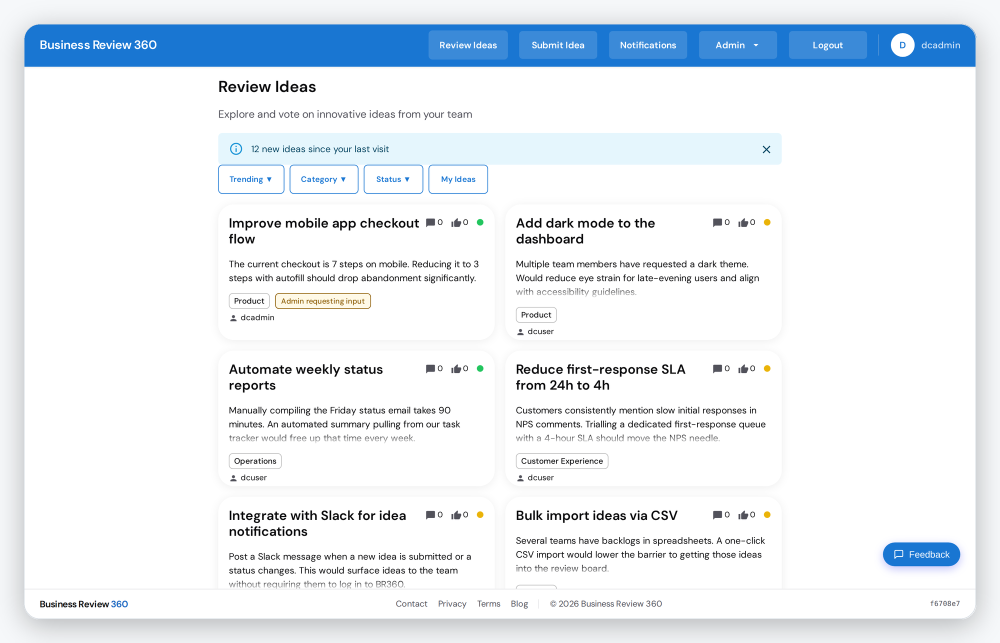
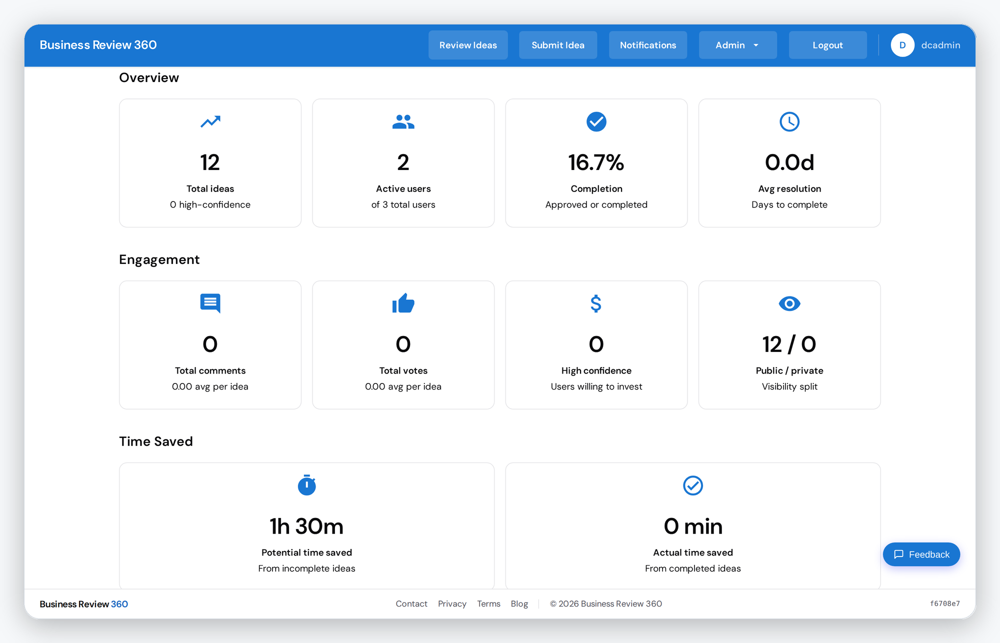
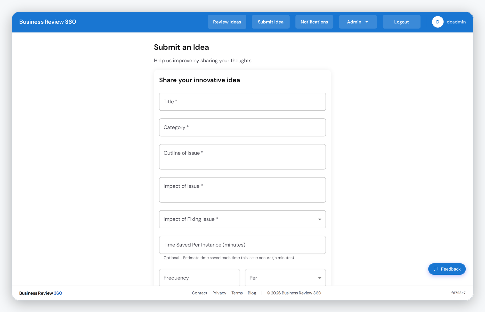
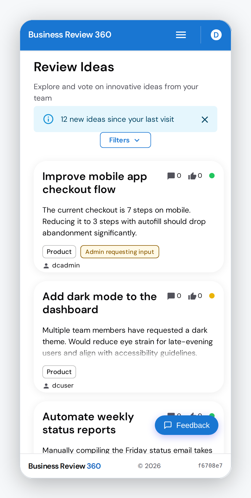
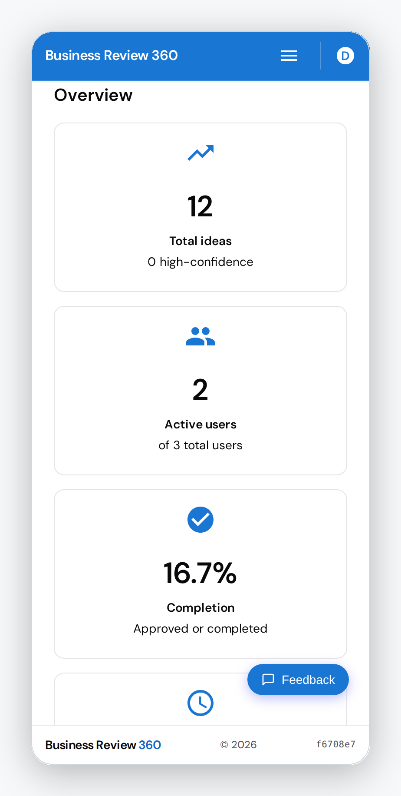
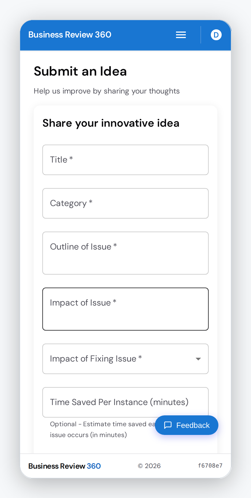

# Business Review 360

[](LICENSE)

**TL;DR:** a multi-tenant web app where employees submit, vote on and discuss improvement
ideas, and administrators triage them through a workflow. React and Express on PostgreSQL with
row-level tenant isolation. Clone it, run `docker compose up -d db backend`, then start the
frontend with pnpm (see [Local development](#local-development)).

## Status

**Retired and unsupported.** Business Review 360 ran as a hosted product until October 2026. It
attracted no customers, so the service has been shut down and this repository is published as
is under the [MIT licence](LICENSE). There is no hosted version, no support and no roadmap. You
are free to clone it, run it and extend it. The repository is archived, so issues and pull
requests are closed; fork it to carry on.

## Screenshots

<p align="center">
  <picture>
    <source media="(prefers-color-scheme: dark)" srcset="docs/images/review-desktop-dark.png">
    
  </picture>
</p>
<p align="center">
  <picture>
    <source media="(prefers-color-scheme: dark)" srcset="docs/images/analytics-desktop-dark.png">
    
  </picture>
  <picture>
    <source media="(prefers-color-scheme: dark)" srcset="docs/images/submit-desktop-dark.png">
    
  </picture>
</p>
<p align="center">
  <picture>
    <source media="(prefers-color-scheme: dark)" srcset="docs/images/review-mobile-dark.png">
    
  </picture>
  <picture>
    <source media="(prefers-color-scheme: dark)" srcset="docs/images/analytics-mobile-dark.png">
    
  </picture>
  <picture>
    <source media="(prefers-color-scheme: dark)" srcset="docs/images/submit-mobile-dark.png">
    
  </picture>
</p>

Captured from a demo organisation with seeded fixture data at desktop (1440x900) and phone
(390x844) viewports; each image adapts to GitHub's light or dark theme.


## What it does

- **Ideas:** submit, edit, vote, comment (threaded, vote-sorted), filter by status, category and
  trending, with optional anonymous participation.
- **Administration:** user and role management, custom categories and workflow statuses, per
  organisation branding (logo, colours, landing page), CSV, JSON and PDF export, and an
  analytics dashboard.
- **Multi-tenancy:** each organisation lives at `/org/{orgId}` on the apex domain or on its own
  subdomain (`{orgId}.<BASE_DOMAIN>`), with PostgreSQL row-level security enforcing isolation.
- **Accounts and security:** JWT sessions, bcrypt password hashing, reCAPTCHA v3 on anonymous
  registration, role-based access and a login throttle.
- **Billing (disabled):** a Stripe integration (checkout, subscriptions, customer portal) and a
  14-day trial flow are present. No Stripe account is attached: the plan price IDs in
  `db/platform-schema.sql` are `NULL`, so create your own products and prices and set the
  `STRIPE_*` variables before using it.

## Stack

| Layer | Technology |
|---|---|
| Frontend | React 19, Material UI 9, React Router 7, Vite 8, Recharts, Vitest |
| Backend | Node.js 22, Express 5, Sequelize 6, JWT, bcrypt, Resend (email) |
| Database | PostgreSQL 15 (an app database plus a separate control-plane database) |
| Tooling | pnpm workspace, Docker Compose, Playwright, Jest, Testcontainers |

## Local development

Prerequisites: Docker with Compose, Node.js 22 or later, and [pnpm](https://pnpm.io/).

```bash
git clone https://github.com/rodlunt/business-review-360.git
cd business-review-360
cp .env.example .env                       # then fill in the required values
pnpm install --frozen-lockfile

docker compose up -d db backend            # PostgreSQL and the API
pnpm --filter business-review-frontend run dev
```

| Service | URL |
|---|---|
| Frontend (Vite) | <http://localhost:3000> |
| Backend API | <http://localhost:4000> |
| PostgreSQL | `localhost:5432` |

`docker compose up -d` starts the whole stack, frontend included. On a fresh database the
demo organisation (`/org/demo-corp`) is seeded from `db/seed-data.sql`; the accounts and
published development passwords are listed at the top of that file. They are development
fixtures only.

## Configuration

All configuration is environment variables in a single `.env` at the repository root.
`.env.example` lists every variable with comments. The required ones are the database URLs and
credentials, `JWT_SECRET` (64 characters or more) and `FRONTEND_URL`. Optional integrations
are Stripe, Resend (email), reCAPTCHA and ntfy (error notifications). `BASE_DOMAIN` (default `br360.example.com`) sets the
domain used for tenant subdomains.

## Tests

```bash
pnpm --filter business-review-backend test                # Jest unit tests
pnpm run test:integration:ci                              # real Postgres via Testcontainers
pnpm --filter business-review-frontend run test:run       # Vitest
pnpm test                                                 # Playwright e2e (needs the stack running)
pnpm --filter business-review-frontend run lint           # ESLint, backend likewise
pnpm --filter business-review-frontend run format:check   # Prettier, backend likewise
```

CI (`.github/workflows/ci.yml`) runs lint and format, backend, backend integration, frontend
and a dependency audit as independent jobs.

## Known limitations

- Dependencies are not being updated. Production dependencies had no known high or critical advisories at publication; one dev-only advisory (`nodemon > braces`) remains. Run `pnpm audit` and upgrade before deploying anywhere.
- Passwords are hashed with bcrypt at cost 12. A migration to Argon2id was planned and not done.
- There is no enforced second factor on the platform-owner account.
- The seeded demo accounts use a published password. Remove them before a real deployment.
- Stripe billing has not been exercised against a live account since the service shut down.

## Documentation

| Document | Contents |
|---|---|
| [`docs/DATA_MODEL.md`](docs/DATA_MODEL.md) | Entities and relationships |
| [`docs/CONTROL_PLANE_DATABASE.md`](docs/CONTROL_PLANE_DATABASE.md) | The platform database: tenants, plans, subscriptions |
| [`docs/TENANT_RESOLVER.md`](docs/TENANT_RESOLVER.md) | How a request is mapped to a tenant |
| [`docs/ops-rls.md`](docs/ops-rls.md) | Row-level security: policies, roles, how to add a table |
| [`docs/TENANT_CUSTOMIZATION_GUIDE.md`](docs/TENANT_CUSTOMIZATION_GUIDE.md) | Per-organisation branding and settings |
| [`docs/MIGRATIONS.md`](docs/MIGRATIONS.md) | Database migrations |
| [`docs/threat-model-2026-08-19-stride.md`](docs/threat-model-2026-08-19-stride.md) | STRIDE threat model |
| [`docs/EMAIL_SETUP.md`](docs/EMAIL_SETUP.md), [`docs/RECAPTCHA_SETUP.md`](docs/RECAPTCHA_SETUP.md), [`docs/STRIPE_SETUP.md`](docs/STRIPE_SETUP.md) | Wiring up your own accounts |
| [`docs/PROJECT-STRUCTURE.md`](docs/PROJECT-STRUCTURE.md) | Repository layout |

## Licence

[MIT](LICENSE). Copyright (c) 2026 Rodney Lunt.
