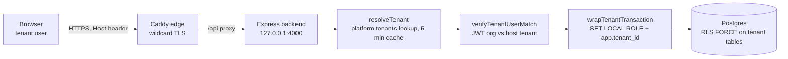
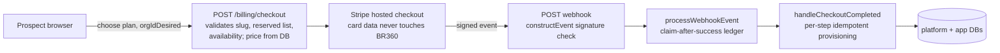
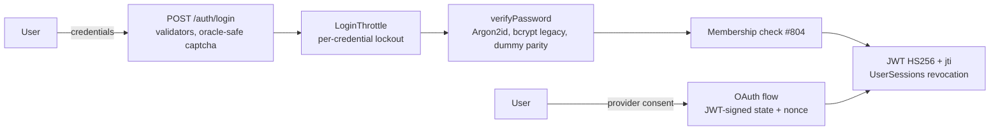

# Threat model: STRIDE over the three trust boundaries (2026-08-19)

Closes #962. First threat-modelling artefact for the platform, scoped per
that issue to the three surfaces where tenants, money and identity meet.
Maintain by diffing: when one of these flows changes shape (#892 lands
magic links, a second payment provider appears, the demo sandbox policy
changes), redo that surface's table, not the whole document.

Method: dataflow diagram per surface, then STRIDE per element crossing a
trust boundary. Every mitigation cites where it lives. Verdicts:
**MITIGATED** (control exists, cited), **ACCEPTED** (risk known, reasoning
recorded), **FINDING** (issue filed).

Topology facts the whole model rests on (verified in `docker-compose.yml`):
the backend binds `127.0.0.1:4000` and Postgres `127.0.0.1:5432`, loopback
only; the sole ingress is the reverse proxy. If either port is ever
published off-host, the Host-header and direct-DB rows below change from
MITIGATED to live threats: re-run this model before doing that.

---

## Surface 1: the tenant boundary

| STRIDE | Threat | Control | Verdict |
|---|---|---|---|
| S | Spoof another tenant via Host header | Caddy routes by vhost so a mismatched Host never reaches the app from outside; backend is loopback-bound so direct requests require host access; subdomain parse accepts single segments and rejects reserved names (`tenantResolver.js:89-95`) | MITIGATED, conditional on the loopback topology above |
| S | Use a JWT minted for tenant A against tenant B | `verifyTenantUserMatch` compares the HS256-pinned JWT's organizationId against the resolved tenant before the transaction (#751); RLS filters the user row anyway as layer two | MITIGATED |
| T | Tamper with another tenant's rows through app bugs | RLS with `FORCE` on all tenant tables, enforced per request via `SET LOCAL ROLE br360_app_user` (#740/#742); service-layer org-scoping convention closes the `findByPk` IDOR class (gotcha #11) | MITIGATED |
| R | Deny having performed an admin action | Audit-log middleware with central redaction, coverage per router documented in `docs/AUDIT_POLICY.md` (forensic scope by policy, not compliance-grade) | MITIGATED at the stated scope |
| I | Read another tenant's data | RLS as above; per-tenant unique indexes; the deliberate exception is demo-corp, a shared sandbox where cross-user visibility is the product design (AUTH_ONBOARDING_PLAN.md locked decision 2) | MITIGATED; demo-corp ACCEPTED by design |
| I | Stale tenant state served from the resolver cache | tenantResolver caches for 5 minutes (gotcha #2), so a suspended or downgraded tenant keeps its old state up to 5 minutes | ACCEPTED: bounded, small blast radius; `clearTenantCache()` exists if an admin kill switch is ever needed |
| D | Exhaust the platform from one tenant | express-rate-limit on abuse-prone routes; plan limits middleware; single-host capacity is the real ceiling and is a scaling posture, not a threat control | ACCEPTED at current scale |
| E | Escalate from demo sandbox to platform powers | Demo users get org-scoped elevation only; consultant management and internal routes require `requirePlatformOwner`, which fails closed when `PLATFORM_OWNER_ID` is unset (`auth.js:226`); profanity settings locked on demo-corp | MITIGATED |

## Surface 2: money (Stripe checkout and webhooks)

| STRIDE | Threat | Control | Verdict |
|---|---|---|---|
| S | Forge a webhook to provision a free tenant | `stripe.webhooks.constructEvent` signature verification (`index.js:202`); Resend webhook likewise secret-gated (`webhooks.js:273`) | MITIGATED |
| T | Tamper with the price paid | Amounts come from the server-side `pricing_plans` table keyed by plan code; the client sends only the code | MITIGATED |
| T | Half-provisioned tenant after a mid-flow failure | Per-step idempotent provisioning with rethrow-and-unclaim so Stripe's retry repairs it (#932, regression-tested) | MITIGATED |
| R | Dispute over whether an event was processed | `stripe_events` ledger with atomic claim; disputes and refunds logged loudly for manual action | MITIGATED |
| I | Card data exposure | Stripe-hosted checkout; no PAN ever transits BR360 | MITIGATED |
| D | Checkout endpoint abuse | `checkoutLimiter` 5/IP/min; reserved-name and format validation before any Stripe call | MITIGATED |
| E | Claim an org slug you should not have | Format + reserved-list validation and availability check at session creation (`billing.js` checkout, `orgIdValidation.js`); org-slug uniqueness in the DB is the provisioning guard | MITIGATED, with one race FINDING below |
| E | Concurrent checkouts for the same slug both charged | Availability is checked at session creation, but two sessions opened in the same window can both reach payment; the second webhook finds the tenant taken and provisions nothing for a paying customer | FINDING: filed as the TOCTOU issue accompanying this model |

## Surface 3: identity (password and OAuth login)

| STRIDE | Threat | Control | Verdict |
|---|---|---|---|
| S | Enumerate accounts via response differences | Identical 401s and full dummy verifies on unknown/split/no-hash/locked paths at real-hash parameters (`passwordHash.js`, parity-tested); lockout counted whether or not the account exists (migration 0022); captcha failures indistinguishable and not lock-counted | MITIGATED |
| S | CSRF the OAuth flow / login-CSRF | State is an HS256-signed JWT carrying a nonce, verified with pinned algorithms on callback (`oauth.js:115,247-316`) | MITIGATED |
| T | Forge or alter a session token | HS256 pinned everywhere it is verified; secret env-required with no fallback; jti blocklist enables revocation (`UserSessions`) | MITIGATED |
| R | Deny a login or admin action | Auth routes audited 5/6 per `docs/AUDIT_POLICY.md`; login attempts logged with outcomes | MITIGATED at stated scope |
| I | Crack a leaked hash database offline | Argon2id at OWASP minimum for new and lazily-migrated hashes (#938, PR #965); bcrypt cost 12 for not-yet-migrated legacy hashes | MITIGATED once #965 lands; interim posture ACCEPTED |
| I | Harvest emails via reset flow | Reset responses uniform; tokens single-use and time-limited (#817-#823) | MITIGATED |
| D | Brute-force lockout as harassment (lock a victim's account) | Lockout is per-credential with escalating strikes; the documented unlock route is the reset flow, which the legitimate owner controls | ACCEPTED: harassment window bounded by throttle windows and self-service unlock |
| E | Reach owner-only surfaces from a tenant session | `requirePlatformOwner` compares user id to env-pinned owner id and fails closed; no MFA beyond provider MFA when OAuth is used, which is the recorded open item on #892's direction | MITIGATED; MFA gap ACCEPTED and tracked |

---

## Outcomes

One new finding filed from this exercise (checkout slug TOCTOU); every
other row lands on an existing control or a deliberately accepted risk with
its reasoning recorded above. Standing conditions to re-check when touching
infrastructure: the loopback bindings in `docker-compose.yml` are
themselves a security control this model depends on, and the reverse-proxy
vhost routing is the outer Host-header defence.
